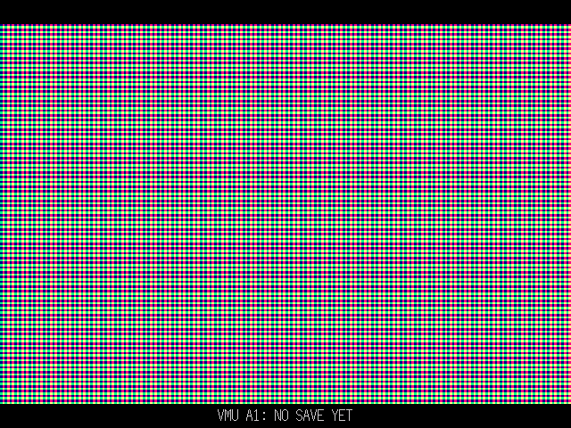

# Klonoa: Empire of Dreams → Dreamcast: technical report 5 — VMU saves and the 3:2 picture

*2026-11-01. All results come from host tests and scripted runs under flycast (§3). No real
Dreamcast, VMU or television was used: everything here is emulator-verified only.*

## Summary

- **Saves go to the VMU.** What the game keeps is the 512-byte image of the cartridge's 4 Kbit
  EEPROM, so that image is what is saved. The game's own save code still runs unchanged.
  - The image goes into two files that take turns. Each copy is read back and compared before it
    counts, so the previous save survives a failed or interrupted write.
  - All VMU I/O happens on a background thread.
  - A save takes about 1–1.5 s, typically finishing within 2 s of the game asking for it.
- **The picture is the largest uniform 3:2 fit in the 4:3 640×480 output.** That is 640 × 426⅔
  at scale 8/3, centred, with black bars above and below.
  - The PowerVR renderer now draws the game at its native 240×160 into a texture, then scales that
    texture, so every game pixel stays one colour.
  - The software renderer uses the same geometry.
- **The VMU screen shows Klonoa in gameplay and a walking Moo in menus.** See report 4,
  [vmu-lcd.md](vmu-lcd.md). It only writes to the LCD and never touches save storage.
- **Two faults found by the final tests, now fixed:**
  - a sound fault at the start of a song when a long frame follows `m4aSoundVSyncOn`; see
    [report 3 §9](audio.md);
  - a second of extra black screen at boot from re-reading each VMU's directory per file (§3).
  
  A third was in a checker: `tools/vmulcd.py` used the wrong "busy" code (report 4).

| | Result |
|---|---|
| Host save tests (`make test-save`) | 65/65 checks pass |
| Save tests in flycast (`tools/save_regress.sh`) | 5 scenarios, all checks pass (new game, restart and continue, damaged copy, no VMU, full VMU) |
| Geometry (`GEOMPROBE`, `tools/geomcheck.py`) | both renderers: 640 × 426 at rows 27–452, 27-row bars, every pixel as expected |
| Visual regression (`tools/regress.sh`) | 19 checkpoints, 0 pixels more than one level apart, 17 bit-identical; bars black in all 19 |
| Sound regression (`tools/audio_regress.sh`) | all checks pass, including a new run with lag frames forced at the start of a song |
| VMU LCD route (report 4) | all checks pass, with five saves to the same VMU during the route |
| Gameplay frame rate (`tests/perf.txt`) | gameplay 59.8 fps as before; slowest boot window 49.0 fps (was 54.1); one frame more display latency |
| 30,000-frame soak | completed: memory flat (801 → 808 KiB, as on the 10,000-frame run), 0 underruns, 0 clicks, five saves written and verified, nothing unsaved at exit |

## 1. VMU saves

### What the game saves, and when

Klonoa's save code is `kleod src/save.c`. On the GBA it writes the cartridge's 4 Kbit serial
EEPROM (`IdentifyEeprom(4)`): 64 double-words.

**Layout:**
- **Three save files** at double-words 0x00, 0x10 and 0x20. Each has:
  - double-word 0: the slot header `"K_KLONOA"`;
  - 1–5: the scene record;
  - 6–14: the file record.
  
  The scene and file records each carry the game's own add and xor checksums. `LoadSaveFile`
  checks them and retries up to 10 times.
- **Double-word 0x30:** the last file used.

**When the game writes:** it writes synchronously, a few double-words at a time.
- `LoadGlobalSaveData`, at boot and on return to the title. It formats slots without a header
  and writes the last-used number.
- `WriteSaveFile` and `WriteCurrentSaveFile`:
  - starting or continuing a file;
  - entering a vision;
  - the world map and the vision select;
  - after the story cutscene;
  - continuing after a game over.
- `DeleteAllSaveData`, which zeroes all 64 double-words.

There is no backup copy and no other persistent state. The game never shows a "saving" message
or reports a failure: on the cartridge a write takes milliseconds.

### What the port stores

`hal_eeprom.c` keeps the 512-byte image in RAM and serves the game's EEPROM calls from it, exactly
as before. A write that changes the image bumps a counter. `hal_save.c` takes it from there.

**The record** (`hal_save_core.h`): 544 bytes, little-endian.

| Offset | Field |
|---|---|
| 0 | magic `"KLEODSAV"` |
| 8 | version (1) |
| 10 | header length (32) |
| 12 | data length (512) |
| 16 | sequence number, +1 per save |
| 20 | CRC-32 of the data |
| 24 | CRC-32 of bytes 0–23 |
| 28 | reserved |
| 32 | the 512-byte EEPROM image |

No compression: 512 bytes do not need it.

**The files.** There are two, `KLONOAEOD_A` and `KLONOAEOD_B`. Each is a VMS file with:
- the file-manager header (`vmu_pkg`: "KLONOA EOD", "Klonoa: Empire of Dreams (DC port)");
- a one-frame 32×32 icon, the letters "KL" drawn with the KallistiOS minifont (not game art);
- the record.

That makes 128 + 512 + 544 = 1,184 bytes, or **3 blocks per file and 6 blocks for both**, of the
VMU's 200.

**Saving:**
1. Once per frame the game thread notices a changed image and copies it to a staging buffer. A
   seqlock means the game never waits.
2. A writer thread waits until the image has been unchanged for 0.5 s. A transition writes its
   scene record and its file record a few frames apart, so this makes them one save.
3. It writes the record into whichever file does *not* hold the newest valid save
   (`vmufs_write`).
4. It reads the file back and compares it with what it wrote. Only then is the save counted.

So a write that fails or is cut short damages at most the file being written. The previous save in
the other file is untouched.

**Loading.** At boot, before the game first reads its EEPROM, every VMU is read. The valid record
with the highest sequence number is loaded; numbers wrap, so 0 counts as newer than 0xFFFFFFFF.
That VMU is then the one saves go to. If it is unplugged later, the first VMU present is used:
its files are read first, so the save lands in the right one of the two. A file is ignored when:
- it is truncated;
- it is not ours;
- its CRCs are wrong;
- its lengths are wrong;
- its VMS header's own CRC is wrong.

**What is never written:**
- **A blank image.** If no game file has been started and the VMU has no save yet, nothing is
  written, so booting alone creates no files.
- **A newer version's file.** If a file from a newer version of the format is found, it is not
  loaded and never overwritten: saving is switched off and the status line says so.

**Failures** never crash and never change the game's in-memory state:

| Case | What happens |
|---|---|
| No VMU | Nothing is written. "NO VMU - PROGRESS NOT SAVED" stays on screen while there is unsaved progress. Retried every 3 s, so inserting a VMU saves it. |
| VMU full (fewer than 3 free blocks, counting the file being replaced) | Nothing is written. "VMU A1 FULL (3 FREE BLOCKS NEEDED) - NOT SAVED". Retried every 3 s. |
| Write or verify error | The other file still holds the previous save. "VMU A1: SAVE FAILED - RETRYING", retried every 3 s. |
| Damaged files at boot | The newest valid one is used. If none is valid: "SAVE DATA DAMAGED - NOT LOADED", and the game starts blank. |
| Success | "VMU A1: SAVED" for 2.5 s. At boot: "SAVE LOADED" or "NO SAVE YET". |

**The status line** is the only on-screen addition. It is a line of text in the bottom letterbox
bar, outside the game picture (§2); the game's own screens are unchanged. Each line is also
logged.

**Threads.** The writer runs one step above the game thread's priority and below the sound
thread's. It is asleep or waiting on the maple bus nearly all the time, and its bursts of CPU are
short. When it ran *below* the game thread it starved: each maple step waited for KallistiOS's
priority ageing, and a save only finished once the game stopped. VMU I/O never runs in the frame
loop or on the game thread.

**Differences from the cartridge:**
- The game believes a save has succeeded as soon as its EEPROM calls return, as it does on the
  GBA. The VMU write lands about 2 s later.
- Switching the console off during those 2 s loses that save. The previous save is kept.
- A failure cannot be reported through the game's own UI, which has no such message; the status
  line reports it instead.
- The game's three slots and its "delete all data" behave as on the cartridge. Writes that the
  cartridge would do as separate double-words become whole-image saves: stronger, never weaker.

## 2. The 3:2 picture in a 4:3 frame

**Measured, not assumed.** The port sets `vid_set_mode(DM_640x480, PM_RGB565)`. The log confirms
a 640×480 output, which is shown as 4:3, so pixels are square.

**The geometry.**
- The GBA picture is 240×160, which is 3:2. A 3:2 picture is *wider* than 4:3, so the largest
  uniform fit is limited by the width.
- The scale is min(640/240, 480/160) = 8/3. That gives 640 × 426⅔ at (0, 26⅔), with black bars
  of 27 rows above and below. Screen rows 27–452 show the game.
- 8/3 is not a whole number. With nearest-pixel sampling, as the renderers already used, each game
  pixel covers 3, 3, 2, 3, 3, 2 … screen pixels in both directions. The scale is the same both
  ways, so nothing is stretched.
- The previous output was a 2× picture, 480×320, with bars all round.
- (A 720-pixel-wide 3:2 picture would need a 720-pixel framebuffer, and there is none in this
  mode.)

**How it is drawn.** The game's own coordinates are untouched; both renderers apply the geometry
only when presenting (`hal.h`).
- **PowerVR:**
  - The game is drawn 1:1 into a 256×256 texture with `pvr_scene_begin_rtt`, 240×160 used.
  - A second, one-quad scene draws that texture over the screen, plus the status line.
  - Scaling the game's polygons by 8/3 instead would have sampled rotated and zoomed layers
    several times inside one game pixel, giving detail the GBA does not have. Affine backgrounds
    are on screen in 84% of the frames of the test route, and the regression's world-map frames
    differed by 1,287 pixels.
  - The presentation scene is submitted *before* the frame's own render. That keeps the one wait
    for the display at the start of the frame. Submitted after, the wait fell mid-frame and cost
    up to 12 fps in heavy scenes.
  - The price is **one frame (16.7 ms) between the game drawing a picture and the screen showing
    it**.
- **Software renderer:** the same mapping, from a column table and a row table.
- **Inside the picture:** clipping, sprite priority, transparency, blending, affine effects,
  windows, transitions and the HUD are all drawn by the unchanged 1:1 game scene, so they stay
  inside the game texture. The bars hold only the status line.

## 3. Tests and results

### Saves

**Host** (`make test-save`, `tools/save_test.c`): 65 checks against a mock VMU that counts blocks
like the real one. All pass. They cover:
- the record round trip and every rejection: truncated, magic, CRC, version 0, newer version,
  wrong length;
- an empty VMU, and a save that loads after a restart;
- ten repeated saves, alternating files;
- a failed write, then a retry;
- a write that silently stores half a file, caught by the read-back;
- a damaged newest copy, which falls back to the older one, and both copies damaged;
- a foreign file under our name;
- a newer version, which is neither loaded nor overwritten;
- a full VMU (2 and 3 free blocks);
- no VMU, then one inserted later;
- the sequence wrapping.

Four faults injected into the store were each caught:
- no read-back;
- always writing file A;
- an unsigned sequence comparison;
- a skipped data CRC.

**Flycast** (`tools/save_regress.sh`, input `tests/save.txt`). The VMU images are kept between
runs (`Dreamcast.VMUPath`) and checked independently with `tools/vmuimg.py`:

| Run | What is checked | Result |
|---|---|---|
| 1. Empty VMU, new game | boot reports "NO SAVE YET"; the game saves on the way to the world map; written and read back; nothing left unsaved at exit; the VMU image holds `KLONOAEOD_A`, 3 blocks | pass (seq 1, written and verified in 1,244 ms) |
| 2. Restart with that VMU | the save loads (same EEPROM CRC, `7a3d567f`); file 1 is continued (`TransitionFromFileSelectToLevel`), not started anew; the file select screen differs from run 1's; the next save goes to the other file; both files present | pass (seq 2 in `KLONOAEOD_B`, 993 ms) |
| 3. Newest copy damaged (`vmuimg.py corrupt`, one byte of `KLONOAEOD_B`'s data) | the older copy, seq 1, loads | pass |
| 4. No VMU (flycast with both VMU slots empty) | boot and the game's save each show the no-VMU line; the attempt fails cleanly; the game runs on to the world map | pass |
| 5. Full VMU (`vmuimg.py fill`, 2 blocks free) | the save is refused for lack of space; the status line says so; the game runs on; nothing written | pass |

The VMU LCD route (report 4) also saves through the normal UI: five saves to VMU A1 between the
file select and Vision 1-1 (frames 1208–2280), each written and verified in 0.97–1.23 s while the
VMU screen was updating.

**Boot.** Reading the VMUs happens before the game's first frame, because the game reads its
EEPROM in that frame. Each VMU costs one directory read (root block, 13 directory blocks, FAT: 15
block reads of one maple frame each), plus 3 blocks per save file found. With flycast's two empty
VMUs, that is 0.50 s. The first version looked each file up with `vmufs_read`, which reads the
whole directory again for every lookup, and took 1.02 s.

The game's normal UI was used throughout:
- title → file select → file 1 → new game → world map, which saves on the way;
- after a restart, the same presses continue file 1 through the file select
  (`TransitionFromFileSelectToLevel`), and the file select screen shows the saved file.

**Not tested:**
- a real VMU: emulator only;
- pulling a VMU out mid-write (the host test covers write failures);
- a newer-version file in flycast (host only).

### Display

**Geometry probe.** `GEOMPROBE=N` builds draw a 240×160 test card through the normal
presentation path, and hand frame N's whole 640×480 picture to the host. The card is red where
x is odd, green where y is odd, and blue everywhere. `tools/geomcheck.py` then checks:
- 640 × 426 rows starting at row 27, with 27 black rows above and below;
- 240 columns and 160 rows, each 2 or 3 pixels, repeating 3,3,2;
- every screen pixel is the game pixel under its centre at scale 8/3;
- the bars are black outside the status line.

| | PowerVR | Software |
|---|---|---|
| Picture rows / columns | 27–452 (426) / 0–639 (640) | 27–452 (426) / 0–639 (640) |
| Bars | 27 rows above, 27 below, black | 27 rows above, 27 below, black |
| Aspect (measured width / height) | 1.5023 (3:2 = 1.5; 426 of the exact 426.7 rows) | 1.5023 |
| Game columns and rows | 240 and 160, widths and heights 3,3,2 | 240 and 160, 3,3,2 |
| Pixels differing from the expected game pixel | 0 | 0 |

**Output mode.** `vid_set_mode` reports `640x480 VGA` with flycast's cable set to VGA
(`Dreamcast.Cable=0`): 31 kHz progressive, i.e. 480p. On flycast's default composite cable,
KallistiOS picks `640x480IL`, which is interlaced NTSC. Both are 640×480 shown at 4:3, and the
geometry is identical.

**Visual regression** (`tools/regress.sh`, 19 checkpoints from boot to Vision 1-1). Every
checkpoint compares the PowerVR screen with the software renderer: 0 pixels more than one colour
level apart, and 17 of 19 bit-identical.
- Each dumped frame's bars are also checked (`BARS` lines).
- Two frames are within one colour level rather than bit-identical: the file select fade and the
  text box. Flycast keeps render-to-texture results at its host's 8-bit precision, where the
  hardware stores RGB565. That is untested on a console.

### Performance

`tests/perf.txt`, 10,000 frames, sound on; before = `6dcd737`:

| | Before (`6dcd737`) | After (`5dd05ff`) |
|---|---:|---:|
| Gameplay (Vision 1-1): mean / slowest 120-frame window / worst frame | 59.8 / 58.1 fps / 58.3 ms | 59.8 / 57.5 fps / 62.2 ms |
| Boot → level entry: mean / slowest window | 58.7 / 54.1 fps | 57.7 / 49.0 fps |
| Whole run: mean / slowest window | 59.5 / 54.1 fps | 59.3 / 49.0 fps |
| Frames over 33 ms / worst | 14 / 90.2 ms | 9 / 92.0 ms (all before frame 2280: loads) |
| Texture conversion + submission per gameplay frame | 3.31 + 3.04 ms | 3.34 + 11.11 ms |
| Sound underruns | 0 | 0 |
| Main RAM heap in use | 768 KiB | 801–808 KiB |

What the rows show:
- **Gameplay is unchanged at 59.8 fps.**
- **"Submission" now includes the wait for the display.** Presenting the previous frame's texture
  starts the frame, and that is where the frame waits for the vertical blank: before, that time
  was counted as idle (8.15 ms). Gameplay CPU time is otherwise the same.
- **The slowest boot window, the text box before the first level, drops from 54.1 to 49.0 fps.**
  That scene was already the heaviest. The render-to-texture pass plus the full-screen quad add
  enough PowerVR work there to miss more vertical blanks.
- **The display is one frame (16.7 ms) later** than before (§2).
- **The two VMU features cost little CPU per frame.** The saves add a 512-byte staging copy, made
  only when the image changed. Report 4 measured the LCD at about 40 µs per frame.

**Soak** (`tests/soak.txt`, 30,000 frames, `AUDIOCHECK=1`):
- completed;
- heap 801 KiB at boot and 808 KiB at the end, the same as the 10,000-frame run's;
- gameplay 59.8 fps, with a slowest window of 57.3;
- sound: 0 underruns, 0 ring overflows and 0 clicks. Rests in the music: 309 in the produced
  stream up to frame 29,881 and 315 in the first 499 s of the flycast capture, against 311 and 320
  in report 3's soak;
- saves: five written and verified on the way into Vision 1-1 (seq 1–5, 0.97–1.24 s each), none
  needed after that, and "everything saved" at exit.

## 4. Limitations

- **No real hardware:** emulator-only for the VMU, its timing and block writes, the
  render-to-texture path, and the display on a television.
- **Saves are asynchronous:**
  - up to about 2 s of progress can be lost if the console is switched off right after the game
    saves;
  - a VMU swapped mid-game receives the next save, but the save on the removed VMU is not
    carried over.
- **One frame of display latency**, from the render-to-texture presentation (§2), and a slower
  heaviest boot scene: 49.0 fps instead of 54.1 in the text box before the first level.
- **Boot reads every VMU before the game's first frame:** about 0.25 s per empty VMU, plus a
  little per save file.
- **While a save writes to a VMU, that VMU's screen pauses** (about 1 s): the save holds the VMU,
  and the screen catches up with the newest picture when it is done (report 4).
- **Cable:** flycast's VGA setting gives 480p; its default composite gives KallistiOS's interlaced
  640×480. No real VGA box or television was used.
- **The bars hold the status line**, which covers rows 458–473 of the bottom bar while a message
  is shown.

## 5. Later: the status line's texture upload (2026-11-01)

A user hit "Fatal: SH4 exception when blocked" in Vision 1-4, under Flycast 2.7 on Windows with a
real BIOS. Searching for it turned up a real fault in this report's display code.

**The fault.** The status line's texture was uploaded with `pvr_txr_load` whenever its text
changed. That function copies through the store queues. With the MMU on, KallistiOS remaps the
store queues through a TLB entry, and blocks of the text's pixels sometimes went to the TA (the
PowerVR's polygon input) instead of texture memory. Flycast logs this as "Unhandled param type
pcw ce59ce59", where 0xCE59 is the text colour.

**How it was found.** A crafted save that continues into World 1's visions and a random-input
exploration run produced 8 such blocks, each after a VMU save changed the text. A stress build
that changes the text every frame, on the regression route, sends 788 garbage blocks in 3,300
frames with `pvr_txr_load` and 0 with the fix.

**The fix** (`360deb4`). Every texture upload now uses plain 32-bit stores, as the game's own
textures already did. The visual regression and the geometry probe still pass.

**Not proven.** Whether this caused the user's crash. It has not been reproduced here: flycast
runs here use the HLE BIOS, and several long exploration runs from the crafted save did not
crash with either version.
